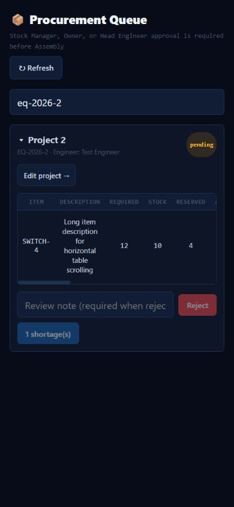
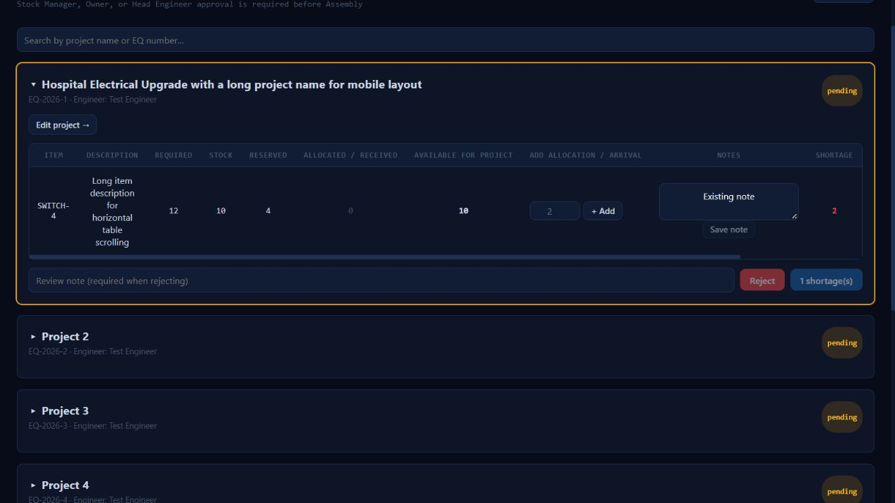

# Application review — 14 October 2026

Reviewed recent procurement, notes, C.R., project versioning and recycle-bin changes; shared authentication, role checks, financial redaction, item scoping, and responsive table layouts.

## Fixed findings

- Project metadata access: secretary and unknown roles could reach project reads directly despite lacking UI access. Project list/detail reads now explicitly permit only owner, head engineer, engineer and accounting. Assignment restrictions still apply to engineers.
- Procurement crashed on the installed MySQL version because JSON_ARRAYAGG was unavailable. Notes now use compatible parameterized queries without truncating long notes.
- Procurement cards were ordered by updated_at, causing saved projects to move. They now have stable creation/id ordering.
- Saving only a CRM note invalidated project approval. Note-only requests retain approval, while mixed note/commercial edits still require review; existing read-only locks remain enforced.
- CRM grouped-item headers did not match engineer rows; fixed hidden financial columns, percentage columns, notes alignment and totals visibility.
- Narrow procurement cards could expand to their table width. Grid/card minimum widths and table containment now keep horizontal scrolling inside tables. Long project names wrap and phone controls have larger text/touch targets.
- Unexpected note-save failures could create an unhandled rejection. Note editors now show an error and retain the draft for retry.
- Version restoration omitted legacy project_items. Snapshots/backups now include them; restoration restores quantities, pricing and notes, and rolls back if a required catalog product no longer exists.
- The local database lacked current_version. Applied the additive 20261014_project_retention_versions.sql migration locally; existing data was preserved. No hosted deployment was performed.

## Verification

- 107 automated tests passed, including authorization, cross-project scope, financial redaction, note validation/clearing, approval preservation, recycle retention, rejected snapshots and legacy restoration rollback.
- Production client build passed.
- 244 authenticated API GET requests across four locally available roles completed without HTTP 500 errors after fixing MySQL compatibility.
- npm audit: zero known advisories in server production dependencies and client dependencies, including development dependencies.
- Fresh schema import, repeated import and integrity checks passed for 39 tables in an automatically removed temporary database.
- Browser checks used synthetic data at 390px and 1280px widths. Search by EQ, expansion, note save, retained expanded state and plain-text handling were checked. Neither width produced document-wide horizontal overflow; tables scroll inside their containers. A fresh direct preview logged no console errors.
- Git diff whitespace checks passed. No tracked .env, .pem or .key files were found by filename scan.

## Limits

This is a targeted local review, not a guarantee that every defect has been found. Accounting, stock manager and secretary lacked local accounts for the live API sweep; their relevant role/scoping behavior is covered by automated tests. Browser checks used synthetic procurement fixtures, not real server writes or every application screen. Hosted configuration, TLS, backups, external email delivery, and production concurrency were not exercised. Restart the local server to load backend fixes; hosted deployment remains outstanding.

